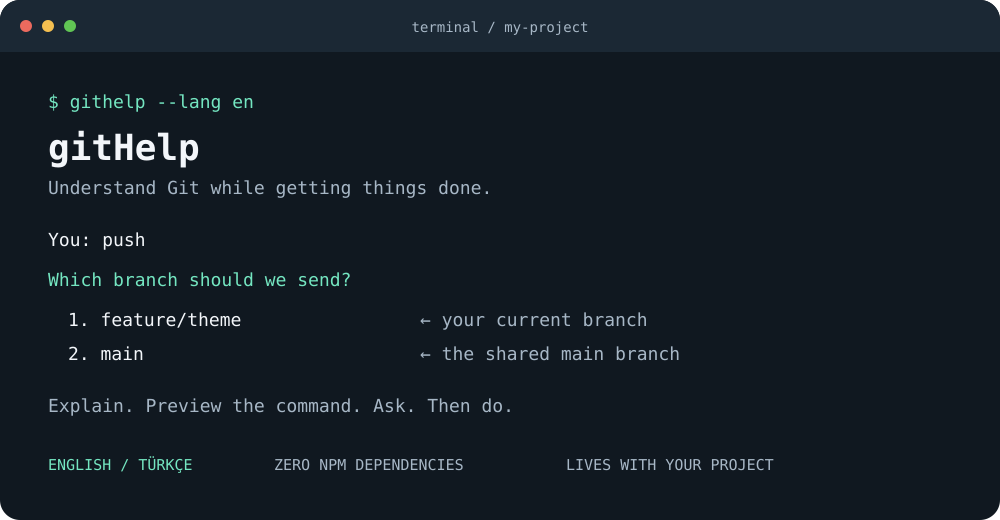

<p align="center">
  
</p>

# gitHelp

**Git’i anlayarak kullan.**

Bir proje yaptın. Şimdi commit, push, origin, main, branch… Hepsini ezberlemek zorunda mısın?
gitHelp terminalinde yanında oturur: ne yapmak istediğini sorar, sade Türkçe veya İngilizceyle açıklar,
çalışacak gerçek komutu gösterir ve onayını aldıktan sonra yapar.

[English](README.en.md) · [Katkıda bulun](CONTRIBUTING.md) · [Nasıl çalışıyor?](docs/architecture.md) · [MIT lisansı](LICENSE)

## Hemen dene

Gerekenler: **Node.js 22+**, **Git 2.28+**. Yeni GitHub reposu veya PR açmak için ayrıca
[GitHub CLI](https://cli.github.com) gerekir. gitHelp’ın harici npm bağımlılığı yoktur.

Bu klasörde tek komutla aç:

```sh
npm start
```

Önce hiçbir şeye dokunmadan bir örnek görmek istersen:

```sh
npm run demo
```

## Türkçe veya İngilizce seç

Menüler, öğretici açıklamalar, sorular, onaylar ve gitHelp hata mesajları iki dilde çalışır:

```sh
npm start -- --lang tr
npm start -- --lang en
```

Kısa komut bağlandıktan sonra `githelp --lang en` veya doğrudan `githelp push --lang tr` kullanabilirsin.
Öğretici tur da iki dilde açılır: `npm run demo -- --lang en`.

Dil önceliği: **`--lang` → `GITHELP_LANG` → sistem dili**. Sistem dili için `LC_ALL`, `LC_MESSAGES`,
`LANG`, ardından işletim sisteminin varsayılan locale bilgisi kullanılır. Türkçe dışındaki desteklenmeyen
locale değerlerinde İngilizce açılır. Seçim çalışma süresince geçerlidir; proje dosyalarına ayar yazılmaz.
Git ve GitHub CLI’nin kendi teknik çıktıları, bu araçların dil ayarlarından gelir.

PowerShell’de tercihi terminal oturumu için ayarlamak istersen:

```powershell
$env:GITHELP_LANG = 'en'
npm start
```

> İlk sürüm kaynak koddan çalışmaya hazırdır. Paket henüz npm’de yayımlanmadı;
> `npx githelp` şu anda bu projeye ait doğrulanmış bir kurulum yöntemi değildir.

## Günlük kullanım

Komutsuz başlatıldığında bir menü açılır. Numara seçebilir veya `push` gibi bir komut yazabilirsin.
Her işlemden önce ne olacağını ve çalışacak Git komutunu görürsün. Onayda Enter’ın varsayılanı **hayır**dır.
Bir işlem tamamlanınca menüye dönersin; çıkmak için `0` seçebilirsin.

```text
gitHelp: Hangi dalın kayıtlarını gönderelim?

  1. ozellik/tema — şu an çalıştığın dal
  2. main — ortak ana dal

Sen: 1

gitHelp: Hangi uzak repoyla çalışalım?
  1. origin — https://github.com/ornek/proje.git

Sen: 1

gitHelp: ozellik/tema → origin/ozellik/tema
           [çalışacak gerçek komutu gösterir]

Bu işlemi yapalım mı? [hayır] > evet
✓ Kayıtların gönderildi.
```

Küçük çalışma döngün:

```text
branch → kodunu yaz → status → commit → push → pr
                      ↑
            arkadaşlarının kayıtları için pull
```

## Her projede kısa komutla kullan

gitHelp klasöründe bir kez yerel komutu bağla:

```sh
npm link
```

Sonra **kendi projenin terminalinde**:

```sh
githelp
```

Doğrudan bir işi de seçebilirsin:

```sh
githelp push
githelp pull
githelp commit
githelp branch
```

PowerShell script çalıştırma ilkesi npm komutlarını
engelliyorsa `npm.cmd start` / `npm.cmd link` veya doğrudan `node src/cli.mjs` kullanabilirsin.

## Aracı projenin `.github` klasöründe tut

Hedef projenin terminalinde:

```sh
githelp kur
```

Bu işlem bağımsız çalışan aracı `.github/githelp/` altına kopyalar. Artık o projede tek komut yeter:

```sh
node .github/githelp/cli.mjs
```

Kurulan araçta da dil seçebilirsin: `node .github/githelp/cli.mjs --lang en`.

Örneğin dal seçerek push başlatmak için:

```sh
node .github/githelp/cli.mjs push
```

Global komut bağlamadan da, gitHelp kaynak klasöründen bir hedefe kurabilirsin:

```sh
node src/cli.mjs kur "../benim-projem"
```

`.github/githelp/` dosyalarını kendi projende commit edersen ekip arkadaşların Node.js ve Git ile
aynı komutu kullanabilir. Kurulum, projenin `package.json`, `.env`, `.gitignore` veya workflow
dosyalarını değiştirmez. Mevcut `.github/githelp` klasörünün üzerine yazmaz. Güncellemede yeni
sürümü ayrı bir klasöre kurup değişiklikleri inceleyerek taşı; kaldırmak için bu klasörü kaldırabilirsin.
Bu bir terminal aracıdır; `.github` altında bulunması onu otomatik çalışan bir GitHub Action yapmaz.

## İlk kez GitHub’a göndermek

Kendi projenin kök klasöründe sırayla:

```sh
githelp baslat
githelp doktor
githelp commit
githelp yayinla
githelp push
```

- `baslat`: Henüz Git yoksa kayıt defterini `main` dalıyla açar.
- `doktor`: Kurulumu kontrol eder; gerekirse yalnız bu projeye commit adı ve e-postası ekler.
- `commit`: Dosya numaralarını ve bir kayıt açıklamasını sorar.
- `yayinla`: GitHub CLI oturumu ile repo oluşturur. Özel / herkese açık seçimini sorar; varsayılan özeldir.
- `push`: Dalını ve uzak bağlantını seçtirip commit’lerini gönderir.

GitHub’da repon zaten varsa `yayinla` yerine `bagla` kullan. HTTPS ve `git@github.com:...` biçimindeki
SSH adresleri desteklenir. GitHub CLI kurulu değilse [GitHub’da boş repo aç](https://github.com/new),
sonra `bagla` ve `push` ile devam et. Git erişiminin HTTPS veya SSH ile ayrıca hazır olması gerekir.

GitHub CLI girişi, aracın dışında ve kendi terminalinde yapılır:

```sh
gh auth login
```

HTTPS kimliğini Git’e bağlamak gerekiyorsa: `gh auth setup-git`. Tokenını gitHelp’a yazman gerekmez.

## Komut sözlüğü

| Komut | Türkçe karşılığı | Yaptığı iş |
| --- | --- | --- |
| `status` | `durum` | Değişen dosyalar, dal ve son bilinen uzak kayıt farkı |
| `commit` | `kaydet` | Dosya seçimi → kayıt açıklaması → yerel commit |
| `push` | `gonder` | Yerel dal seçimi → uzak bağlantı → aynı adlı dala gönderim |
| `pull` | `al` | Çalıştığın dalı seçilen uzak bağlantının aynı adlı dalından güncelleme |
| `branch` | `dal` | Yeni yerel dal oluşturma veya yerel dal değiştirme |
| `pr` | — | GitHub’da mevcut dal için taslak pull request |
| `baslat` | `init` | Bu klasörde Git başlatma |
| `bagla` | `connect` | Var olan GitHub adresini yeni remote olarak ekleme |
| `yayinla` | `publish` | GitHub’da özel veya herkese açık repo oluşturma |
| `doktor` | `doctor` | Araçlar, kimlik ve bağlantı kontrolü |
| `ogren` | `learn` | Git, branch, stage, commit, push, pull, PR ve conflict açıklamaları |
| `kur [klasör]` | `install` | Bağımsız `.github/githelp` kurulumu |
| `demo` | — | Git çalıştırmayan örnek tur |

`gönder`, `bağla`, `başlat`, `yayınla`, `öğren` ve `yardım` yazımları da desteklenir.
Kaynak klasöründe doğrudan kullanım: `node src/cli.mjs push` veya `npm start -- push`.

## Önce prova yap

```sh
githelp push --dry-run
githelp commit --dry-run
githelp kur --dry-run
```

`--dry-run` dosya değiştiren veya uzak servis üzerinde işlem yapan komutları **çalıştırmaz**;
yalnızca planı gösterir. Yerel durum okumaları ve PR/repo işlemlerindeki GitHub CLI oturum
kontrolleri yapılabilir. GitHub CLI’nin kendi `pr create --dry-run` bayrağı kullanılmaz.

Renkleri kapatmak için `--no-color` veya `NO_COLOR` ortam değişkeni kullanılır.
Seçimlerde `0`, her yerde `Ctrl+C` ile çıkabilirsin. Araç tamamlanmış bir adımı otomatik geri almaz.

## Dosyaların ve geçmişin nasıl ele alınır?

- Commit’ten önce dosyaları sen seçersin; yalnız bu dosyalar `git add` ile hazırlanır.
- Daha önce stage edilmiş ama seçmediğin dosyalar varsa işlem durur. Gizlice commit’e eklenmezler.
- Seçtiğin dosyanın **tüm güncel hali** kaydedilir; satır bazında kısmi commit bu sürümde yoktur.
- `.env`, özel anahtar ve benzeri dosya adları seçildiğinde commit durur. `.env.example` gibi şablonlar kabul edilir.
  Bu, dosya adına dayalı bir kontroldür; dosya içeriklerini veya geçmiş commit’leri tarayan bir gizli bilgi tarayıcısı değildir.
- Push, seçilen yerel dalı uzaktaki **aynı adlı** dala gönderir. Başka dalı `main` üzerine eşlemez,
  ayrıca tag veya alt modül göndermez. Birden fazla push adresi olan bağlantılarda işlem durur.
- Pull yalnızca fast-forward ile ilerler. Ayrılmış geçmişte otomatik merge veya rebase yapmaz.
  Fetch aşaması uzak referansları güncelleyebilir; bu, çalışma dosyalarının birleştirildiği anlamına gelmez.
- Dal değiştirme ve PR açma için temiz çalışma alanı gerekir. Yeni dal oluştururken yerel değişiklikler korunur.
- Yarım kalmış merge/rebase işlemlerinde araç durur. Force push, reset, dal silme ve otomatik çakışma çözümü yoktur.
- Git’in hook, imzalama ve kimlik doğrulama ayarları geçerlidir. Bir hook hata verirse bazı önceki adımlar,
  örneğin dosyaların stage edilmesi, tamamlanmış olabilir; `status` ile kontrol edebilirsin.

PR akışı bu ilk sürümde aynı GitHub reposundaki dallar içindir. Fork’lar arası PR, GitHub Enterprise,
uzak dal checkout’u, özel upstream adlarıyla pull ve merge/rebase yönetimi kapsam dışındadır.
PR açmadan önce mevcut dalın son commit’inin seçilen GitHub reposuna gönderildiği kontrol edilir.

## Geliştirme

```sh
npm run check
npm test
npm pack --dry-run
```

Testler geçici klasörlerde gerçek Git repoları ve yerel bare uzak repolar oluşturur. Kullanıcının global
Git ayarlarını okumaz, GitHub’a bağlanmaz, gerçek hesaba push veya PR işlemi yapmaz.
GitHub PR/repo servisleriyle canlı uçtan uca testler bu paketin otomatik testlerine dahil değildir.

GitHub Actions için Windows, macOS ve Linux üzerinde Node.js 22/24 test matrisi hazırdır.
Bu matristeki uzak çalıştırmalar repo GitHub’a gönderildikten sonra gerçekleşir.

## Açık kaynak

gitHelp MIT lisanslıdır. Yeni başlayan birinin anlayamadığı bir açıklamayı sadeleştirmek de katkıdır.
[Katkı rehberi](CONTRIBUTING.md), [davranış kuralları](CODE_OF_CONDUCT.md) ve [güvenlik politikası](SECURITY.md)
ile başlayabilirsin.
